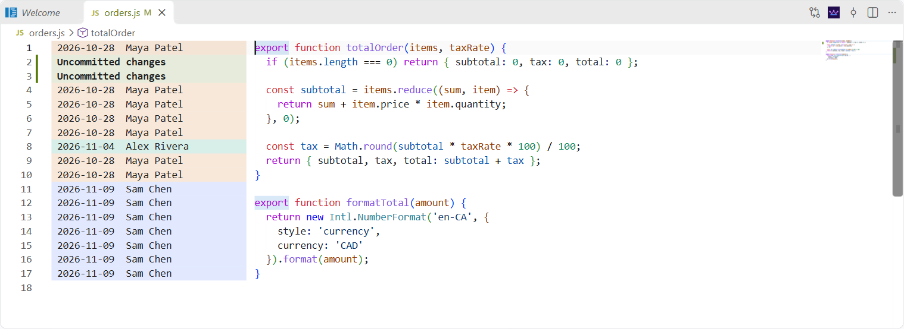
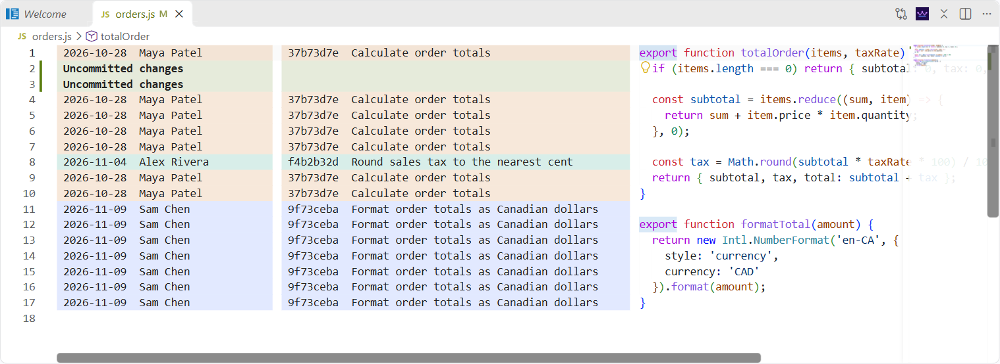

# GitPraise

A better Git blame for VS Code. Praise the coder behind every line.

Show who last changed each line in a Git-tracked file. Click the crown in the editor toolbar and choose **GitPraise: Annotation** to turn annotations on or off. You can also right-click a line number and select **Annotate with GitPraise**, or run **GitPraise: Annotation** from the Command Palette.

- Read the author and date beside each line. The same commit uses the same color throughout the file.
- Choose **GitPraise: Commit Info** from the crown menu to toggle the short SHA and commit subject beside the author and date. Choosing it while annotations are off opens both columns. The commit column starts collapsed when you turn annotations on with **GitPraise: Annotation**.
- Right-click a line number to compare the file with its previous version, copy the full SHA, or hide annotations.
- Edit a file with annotations open. The column refreshes after a short pause and marks lines Git attributes to your working changes.

## Screenshots

### Basic annotations

The author and date appear beside each line.



### Expanded commit column

The expanded column shows the short SHA and commit subject next to the author and date.



## Requirements

Use VS Code 1.110 or later with Git installed and a trusted workspace. The annotation column sits before the code, to the right of the native line numbers. GitPraise supports tracked text files with a committed version in HEAD, up to 25,000 lines and 2 MiB of editor text. Historical text previews decode Git blobs as UTF-8.

## Settings

| Setting | Default | Effect |
| --- | --- | --- |
| `gitPraise.ignoreWhitespace` | Off | Ignore whitespace changes when attributing lines. |
| `gitPraise.detectMovedLines` | Off | Follow moves within the file using Git's `-M` option. |

## Install a local build

In VS Code, run **Extensions: Install from VSIX…** and select `gitpraise-0.0.2.vsix`.

If you installed the earlier **Git Blame Column** preview, uninstall it to avoid duplicate commands. If you customized its settings, replace the `gitBlameColumn.` prefix with `gitPraise.` in your settings.

## Develop

Open the source folder in VS Code. Press **F5** to launch the extension in an Extension Development Host, then open a tracked file in that window.

To check and package the source with Node.js 22 or later:

```sh
npm ci
npm run check
npm test
npm run package
```

## License

Licensed under the [MIT License](LICENSE).
